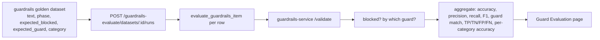

# Guard Evaluation — strategy review and comparison

Date: 2026-11-20
Scope: the Guard Evaluation page, its runner, routes and dataset schema in
`rag-retrieval-chat-manager`; external practice for evaluating guardrails in an LLM or RAG system.
Method: read the code at the cited lines, and checked the three sources at the end.

## 1. What the page does today

| Piece | File | Anchor |
|---|---|---|
| Dataset shape | `libs/eval-core/src/eval_core/guardrails_dataset_schema.py` | 8-20 |
| Row scoring | `libs/eval-core/src/eval_core/guardrails_runner.py` | 44-114 |
| Aggregate | same | 116-200 |
| Run route (synchronous) | `apps/rag-api/src/rag_api/routes/guardrails_evaluate.py` | 254-360 |
| Stored run | `libs/database/src/rag_db/models/guardrails.py` | 74-86 |
| Page | `frontend/src/pages/GuardrailsEvaluationPage.tsx` | hero 617, bars 643-645, categories 683, rows 720 |

The runner scores a row as `expected_blocked == actual_blocked`, and `correct_guard` when both a
guard was expected and one fired. A row whose phase the config's mode excludes is skipped, not
failed. The aggregate is a confusion matrix plus accuracy, precision, recall, F1, guard match
rate and per-category accuracy.

## 2. What a complete evaluation covers

The sources support five dimensions. The first is in place; the rest are partial or absent.

### 2.1 Detection quality against labels

Precision and recall on a labelled set, with the confusion matrix, are the base. Both measure
different failure costs: a false positive refuses a good user, a false negative lets a bad one
through. This is what the page reports.

### 2.2 Over-blocking is a first-class result

Safety alignment over-refuses benign queries, and refusal rate alone is a poor safety proxy
[W1]. A guardrail that blocks everything scores perfectly on a harmful-only set. The evaluation
must carry a benign slice, and the report must name the cost of a false positive in the same
breath as a false negative.

Our set can hold benign rows (`expected_blocked: false`), and the aggregate counts `TN`/`FP`. What
the page lacks is a named benign-pass card, and nothing forces a dataset to contain benign rows.

### 2.3 Phase coverage, and the masking case

Rails run at input, on retrieved content, and on the answer; NeMo's own model is "check at
configured points", with RAG filtering retrieved content and checking answers against evidence
[W2]. Our schema carries `phase`, and the runner honours it.

The gap is the **repair** path. `pii_retrieval` returns masked passages, and the chat route
substitutes them. The evaluation records only `actual_blocked`; a mask that leaves the entity in
place scores as a clean pass. Nothing tests it.

### 2.4 Adversarial robustness, including RAG-specific shapes

Red teaming generates adversarial inputs, runs them, and quantifies the result, ideally in CI
[W3]. For RAG, the application-layer threats are the ones a chat filter misses: indirect prompt
injection inside a retrieved document, PII pulled from context, and exfiltration through links or
markdown [W3]. OWASP lists prompt injection and sensitive information disclosure as the first two
LLM risks [W4].

Our dataset schema can express these as rows (`phase: retrieval`, `category: indirect_injection`,
`metadata.chunks`). No helper generates variants (paraphrase, encoded payloads, other languages),
so coverage is only what an author writes by hand.

### 2.5 Operational cost and regression gates

Every rail spends a model call or a validator pass. The service returns `ms` per rail, and the
chat path logs `guardrails.<phase>.blocked`. Promptfoo recommends running the suite at
pre-deployment and in CI to catch regressions [W3].

Our runs store `guard_results`, which already holds each rail's `ms`, but the aggregate drops it.
Runs are synchronous inside the API request, so a large set times out before it finishes. There
is no threshold check that fails a build.

## 3. Comparison

| Dimension | Recommended | Ours | Gap |
|---|---|---|---|
| Labelled detection quality | precision, recall, F1, matrix | yes | none |
| Guard attribution | per-guard accuracy | `guard_match_rate` | only when both guards are present |
| Per-category slices | accuracy, precision, recall per category | accuracy only | no per-category P/R |
| Benign / over-blocking | named pass rate, benign slice required | FP count only | no card, no enforced slice |
| Phase coverage | input, retrieval, output | yes, with mode skip | — |
| Repair correctness | verify masked entities are gone | not measured | **blind spot** |
| Adversarial variants | generated paraphrases, encodings, indirect injection | hand-written rows | no generator, no slice convention |
| Latency / cost | p50/p95 per rail | `ms` stored, unused | aggregate ignores it |
| Run execution | queued, resumable | synchronous in the request | times out on large sets |
| Regression gate | thresholds in CI | none | no gate |
| Judge calibration | agreement with human labels | none | unverified judge |

## 4. Prioritised changes

Each item names the file and the smallest change that closes the gap.

1. **Latency, from data already stored.** In `aggregate_guardrails_metrics`, read
   `it.guard_results[guard]["ms"]` and add `p50_<guard>_ms`, `p95_<guard>_ms` and a total. Surface
   them as two cards. No new collection, no service change.
2. **Benign-pass card and a required benign slice.** Add `benign_pass_rate` (TN / rows expected to
   pass) and `over_block_rate` (FP / benign rows) to the aggregate; show one card. In the dataset
   upload, warn when no row has `expected_blocked: false`.
3. **Repair check.** Extend the row schema with `expected_masked: list[str]` (entities that must not
   survive). For a `retrieval` row with `on_fail: fix`, assert each entity is absent from the
   returned `chunks`. One boolean per row, one aggregate rate.
4. **Per-category precision and recall.** The category bucket already loops; count TP/TN/FP/FN per
   category and add P/R beside accuracy.
5. **Move the run to the eval worker.** The route loops over rows inside the request
   (`guardrails_evaluate.py:254`). Enqueue on the `eval` queue as the offline evaluation does;
   keep the same run row and status flow. A 100-row set at ~2 s per rail currently cannot finish.
6. **Variant slices as a convention, then a generator.** Document categories such as
   `indirect_injection`, `encoded_payload`, `paraphrase`, `other_language`, and score P/R per
   category. A generator can follow; the categories make the gap visible now.
7. **CI gate.** Add `thresholds` to the run request (e.g. `recall >= 0.95`, `over_block <= 0.02`)
   and return `passed` with the failing names; a script exits non-zero.
8. **Judge calibration.** Pick 50 rows, label them by hand, and store the agreement rate with the
   current judge model. A judge that disagrees with humans turns the whole page into noise.

## 5. Verification

1. `uv run pytest tests/unit -q` after each change; the guardrails runner has unit coverage in
   `tests/unit`.
2. Run the existing guardrails dataset against one config; record `accuracy`, `precision`,
   `recall`, `f1`, `guard_match_rate`, and the new latency and benign cards.
3. Re-run with `on_fail: fix` on `pii_retrieval` and a row whose `expected_masked` names an email;
   the row must fail while the email survives, and pass when the mask removes it.
4. Kill the guardrails service mid-run; every row must carry an `error_message`, the run must not
   report a clean accuracy, and the page must show the failed-row banner it already has.

## Sources

- **[W1]** FalseReject (arXiv 2505.08054): safety alignment "often lead to the over-refusal of
  benign queries"; the benchmark carries 16k queries and a human-annotated test set across 44
  safety categories. https://arxiv.org/abs/2505.08054
- **[W2]** NVIDIA NeMo Guardrails, *Overview*: "checks run at configured points"; RAG systems
  "filter retrieved content and check answers against evidence"; PII can be detected or masked.
  https://docs.nvidia.com/nemo/guardrails/about-nemo-guardrails-library/overview
- **[W3]** Promptfoo, *LLM red teaming guide*: generate adversarial inputs, evaluate, analyse;
  application-layer threats include indirect prompt injection, PII from RAG context and
  exfiltration; run in CI to catch regressions.
  https://www.promptfoo.dev/docs/red-team/
- **[W4]** OWASP Top 10 for LLM Applications 2025, LLM01 Prompt Injection and LLM02 Sensitive
  Information Disclosure. https://genai.owasp.org/llm-top-10/
