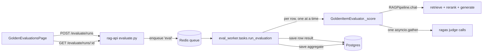

# Offline Evaluation — speed brief and correctness review

Date: 2026-11-17
Scope: `rag-retrieval-chat-manager` — the Offline Evaluation page, its API route, the eval
worker, the `eval-core` scorer, the run aggregate, and the LiteLLM proxy it depends on.
Method: read the code at the cited lines, re-ran the unit suite, ran three real evaluation
rows on the Résumé synthetic smoke set, read the worker log, and checked the external
documentation cited at the end.

## 1. What runs today



| Step | File | Anchor |
|---|---|---|
| Dataset and judge pickers, rows to test | `frontend/src/pages/GoldenEvaluationsPage.tsx` | profile load 755-800, run create 960-985 |
| Run creation, `sample_size`, `judge_model` | `apps/rag-api/src/rag_api/routes/evaluate.py` | 76, 597, 645, 649 |
| Sample, row loop, per-row save, trace | `apps/eval-worker/src/eval_worker/tasks.py` | 226, 234, 264, 296 |
| Scorer: metrics, skip reasons, latency | `libs/eval-core/src/eval_core/runner.py` | 196, 236-256 |
| Judge calls: one gather per row | `libs/eval-core/src/eval_core/ragas_client.py` | 508-535, 544 |
| Judge client: timeout, retries, token budget | same | 68-69, 30 |
| Aggregate: means, coverage, p50/p95 | `libs/database/src/rag_db/repositories/evaluation_repository.py` | 340-430 |
| KPI cards, row counts, Not scored | `GoldenEvaluationsPage.tsx` | 280, 305-307, 335 |

Three properties decide the runtime:

1. **Rows are sequential.** The worker scores one row per loop iteration; nothing runs rows
   concurrently [R1].
2. **One row is one judge wave.** All judge calls a row needs are issued together in a single
   `asyncio.gather` [R2]. Before this change there were three waves in three event loops.
3. **The pipeline is the other half.** A row first calls `RAGPipeline.chat`, and retrieval and
   generation are synchronous calls to the proxy [R3].

## 2. Where the time goes

Measured on run `cf749579` (3 rows, judge `cc-deepseek-v4-flash`, rerank off) [M1]:

| Measure | Value |
|---|---|
| Whole run | 2019 s (33.6 min) |
| Row 1 / 2 / 3 | 7.3 / 9.4 / 16.6 min |
| `retrieve_ms` | mean 32.0 s, p50 25.1 s, p95 59.8 s |
| `generate_ms` | mean 132.0 s, p50 41.8 s, p95 328.1 s |
| `total_ms` (pipeline) | mean 164.0 s, p50 66.9 s, p95 387.9 s |
| Judge time per row | the remainder, 2–5 min |

A single query embedding of `nvidia-embed-textonly` took **117 s** when the proxy was
saturated [M2]. Retrieval, not Qdrant, is the slow part on those turns.

Earlier measurements show what the judge code change bought:

| Row path | One row |
|---|---|
| Three waves, with `NoiseSensitivity` | ~420 s |
| One wave, with `NoiseSensitivity` | ~1110 s |
| One wave, without it, parallel precision | see `cf749579` above |

`NoiseSensitivity` alone awaited `2 + 2 × contexts + 1` judge calls in sequence — 13 calls for a
five-context row [R4]. `ContextPrecision` awaited one call per context [R5].

## 3. Is the evaluation correct?

An independent read of the path confirmed items 1–11 below [R6]; the figure after each is the
audit's evidence.

| # | Claim | Result |
|---|---|---|
| 1 | Rows are scored one at a time | confirmed |
| 2 | The sample is drawn before the loop, and progress caps at `sample_size` | confirmed |
| 3 | One `asyncio.run` holds retrieval + generation + triad per row | confirmed |
| 4 | `NoiseSensitivity` is not called on the eval path | confirmed |
| 5 | Precision verdicts are concurrent, combined by `_average_precision` | confirmed |
| 6 | The judge client uses `timeout=180`, `max_retries=1` | confirmed |
| 7 | `average_precision` divides by `max(len(sources), hits)` | confirmed |
| 8 | The aggregate carries means, coverage, p50/p95, skipped | confirmed (zero-row early return omits coverage) |
| 9 | The page renders the row count per metric and the Not scored line | confirmed |
| 10 | The run stores `judge_model` and the page sends it | confirmed |
| 11 | Latency is stored per row from `ChatResult.latency_ms` | confirmed |

### Corrected in this session

| Defect | Evidence | Commit |
|---|---|---|
| An undefined metric was stored as 0.0 | row without `source_doc_id` produced `hit_at_5 = 0` | `03cf407` |
| `map` could exceed 1 | one source matched several chunks: `map = 2.43` | `7d1d926` |
| Three judge waves, `NoiseSensitivity`, serial precision | 18.5 min for one row | `7d1d926` |
| A stalled judge call waited 600 s and retried twice | 5.8-minute gap in the worker log | `5bc1312` |
| Judge JSON truncated at 8192 tokens and retried | `output is incomplete due to a max_tokens` | `5bc1312` |
| A 3-row sample showed `0/7` | `get_run_progress` used the set size | `7d1d926` |
| The retrieval judge ignored the run's judge | `build_ragas_llm(settings)` with no model | `5b4fdd5` |
| The trace's latency was always empty | `EvalItemResult` had no `latency_ms` | `5b4fdd5` |

### Open risks

1. **Aggregates are frozen at write time.** A change to the metric rules does not recompute an
   old run; its stored means keep the old meaning [R7].
2. **No seed.** The page sends `sample_size` but no `seed`, so two runs of "3 rows" compare
   different rows unless the set has 3 or fewer [R8].
3. **Small samples.** Some metrics cover 2 of 3 rows when a judge call fails or times out; the
   mean is then over a different subset, which the coverage count shows but the card value does
   not [M1]. Three rows cannot support a claim about a pipeline; the docs and the literature
   both warn about inferring model quality from tiny judge samples [W1].
4. **The reranker is off.** `nvidia-rerank` is end-of-life (410) and the two `bge` rerankers
   need Hugging Face, which the proxy cannot reach [M3]. Retrieval scores therefore measure
   dense + BM25 fusion only.
5. **The proxy is a single point.** When it fails, `/v1/model/info` falls back to one chat model
   and every judge call degrades [M4].

## 4. Speed plan

Ranked by expected gain per unit of risk. Each item names its evidence.

### 4.1 Restore the proxy and enable its cache — largest gain

LiteLLM caches `/chat/completions`, `/embeddings` and `/rerank` by default when a cache is
configured, keyed by the whole request; Redis is the default backend and `/cache/ping` verifies
it [W2]. Today the cache is disabled: `#  cache_responses: true` is commented out in
`tharun.yaml:272` [R9].

Why it matters here:

- The same query embedding is requested again on every re-run of the same row.
- RAGAS prompts are long and repeat across runs with the same dataset and config.
- A cache hit removes the 117 s embedding and most of a repeated judge call.

Enable it in `tharun.yaml`, start Redis, and confirm with `/cache/ping`. Expected: repeated runs
drop to the cost of the first; a first run is unchanged.

**Attempted 2026-11-17, then reverted.** The cache block was added to `litellm_settings`
(`cache: true`, `cache_params: redis`, `host.docker.internal:6379`, `ttl: 3600`), but the
container did not bind port 4000 after the restart. A revert to the original config showed the
same failure, so the cause is the container's startup (its `prisma migrate deploy` step hangs),
not the cache block. The change is ready to re-apply once the container starts reliably.

### 4.2 Score rows concurrently — about 2× for a 3-row run

The rows are independent: each creates its own run item and its own session memory. The pipeline
call is synchronous, so a small thread pool is the smallest change:

```python
with ThreadPoolExecutor(max_workers=3) as pool:
    for result in pool.map(score_one, dataset_items):
        save(result)
```

Expected: 33.6 min → about `max(row)` ≈ 17 min for three rows, and flat as rows grow. The ceiling
moves to the proxy: 3 rows × ~11 judge calls issue together. Set the pool size from a setting and
start at 3. The same idea is what `RunConfig.max_workers` gives the ragas batch API [W3].

**Implemented in `8e0135e`** (`score_row` + `ThreadPoolExecutor`), with a per-run override in
`91efb1f`/`00eaea8` and a default of 2 in `f10ddaa`. Each row still creates, saves and reports
its own run item, and a failed row fails alone. The unit suite stays at 305 pass.

**Measured 2026-11-17, same seed, same dataset, one worker, back to back:**

| Row width | Wall time, 3 rows | vs width 1 | Coverage gaps |
|---|---|---|---|
| 1 | 561 s | — | none |
| 2 | **316 s** | **1.78× faster** | `factual_correctness` 2/3 |

The means barely moved: `answer_relevancy` 0.467 → 0.442, `context_precision` 0.833 → 0.841,
`context_recall` 1.0 → 1.0. So the width does not bias the scores; it costs the odd judge call.

A width of 3 was tried first and rejected: 275 s, but `answer_relevancy` failed on **all three
rows** with `Connection error`, and `factual_correctness` covered 1 of 3. Thirty-three
simultaneous judge calls is more than this proxy serves. That is why the default is 2.

### 4.3 Trim the judge set to what the page reports

A row now issues about 11 judge calls. Two are near-duplicates of cheaper ones:

| Metric | Overlaps | Calls per row |
|---|---|---|
| `context_entity_recall` | `context_recall` | 2 |
| `factual_correctness` | `answer_correctness` (same judge, same reference) | 2 |

Both are listed as separate ragas metrics [W4], so dropping them is a choice about what the page
must show, not a library limit. Make them per-run flags with a default of off; the run config
already carries per-run options. Expected: a 3–4 min row becomes 2–3 min.

**Measured cost of `context_entity_recall`.** In the width-1 run of 2026-11-17 it failed on two
rows after **140.2 s** and **167.1 s** with `The output is incomplete due to a max_tokens length
limit` (the judge budget is 16384 tokens, `ragas_client.py:30`). Two and a half minutes per row
bought no score at all. That is the strongest case for dropping it first.

### 4.4 Use a cheap judge for routine runs, a strong judge for the reference run

A judge's design choices move cost by orders of magnitude with limited quality loss [W5]. Keep
`cc-deepseek-v4-flash` (or a smaller non-reasoning model) as the default and reserve the strong
model for a scheduled full run. The run config already stores `judge_model`, so a run stays
reproducible.

### 4.5 Lower `retrieve_limit` for evaluation

The answer sees `top_k = 5` passages; the other 15 only feed the formula metrics. With rerank off
they are pure latency. Try `retrieve_limit: 10` and compare `retrieve_ms` and `precision_at_10`;
the retrieval block reports both, so the trade is visible in one run.

### 4.6 Cache scores per row and config

A row's scores depend on the row, the pipeline config and the judge. A key of
`(dataset_item_id, config_hash)` lets a re-run score only the rows that changed — the usual case
when tuning retrieval. This is a table plus a lookup in the worker; it composes with 4.1.

## 5. Verification

1. `cd rag-retrieval-chat-manager/backend && uv run pytest tests/unit -q` → 305 pass, the same 5
   `test_stats.py` failures [M5].
2. Run 1 row, then 3 rows, on the smoke set; record `items_completed`, the three row durations,
   `retrieve_ms`/`generate_ms` from the aggregate, and the judge log lines.
3. Page check: the Retrieval tab must list `key · N rows`, and a row without a source must show
   the Not scored line instead of zero cards.
4. After 4.1: `/cache/ping` reports `healthy`, and a repeated row finishes without new proxy
   calls in the proxy log.
5. After 4.2: the run duration for 3 rows is about the longest row, not the sum; the progress
   counter still reaches 3/3.

## Sources

Local evidence, by marker:

- **[R1]** `apps/eval-worker/src/eval_worker/tasks.py:234` — the row loop; no pool.
- **[R2]** `libs/eval-core/src/eval_core/ragas_client.py:508-535, 544` — one gather per row.
- **[R3]** `libs/rag-core/src/rag_core/pipeline.py:87-140` — synchronous `retrieve`/`rerank`.
- **[R4]** installed `ragas 0.4.3`, `ragas/metrics/collections/noise_sensitivity/metric.py:152-172`
  — one awaited call per context, plus decompositions.
- **[R5]** installed `ragas 0.4.3`, `ragas/metrics/collections/context_precision/metric.py:105-112`
  — one awaited call per context.
- **[R6]** `AuditEvalPath` scout report, 2026-11-17 — items 1–11 with file:line.
- **[R7]** `libs/database/src/rag_db/repositories/evaluation_repository.py` — the aggregate is
  written by the worker; the API only reads it.
- **[R8]** `frontend/src/pages/GoldenEvaluationsPage.tsx:960-985` — no `seed` in the payload.
- **[R9]** `C:\Users\2782234\CursorProjects\docker-services\litellm\tharun.yaml:272` —
  `# cache_responses: true`.

Measurements:

- **[M1]** run `cf749579-fa3a-471d-92e7-98041d94466e`, 3 rows, `cc-deepseek-v4-flash`, rerank off;
  aggregate read from `evaluation_runs.aggregate_metrics` on 2026-11-17.
- **[M2]** one `EmbeddingClient.embed_text` call with `nvidia-embed-textonly`: 117.13 s, 2048
  dimensions; Qdrant top hit `Resume-1.pdf`.
- **[M3]** `/v1/rerank` with `nvidia-rerank`: HTTP 410, endpoint end-of-life 2026-11-16T09:00Z;
  `bge-reranker-v2-m3|gemma`: 500, `api-inference.huggingface.co` not resolvable from the proxy.
- **[M4]** `/api/knowledge-products/config/litellm-models?model_kind=chat` returned
  `source: fallback` with one model while `/v1/models` timed out.
- **[M5]** `uv run pytest tests/unit -q` on 2026-11-17: 305 passed, 5 failed.

Web:

- **[W1]** *Judging the Judges: A Systematic Evaluation of Bias Mitigation Strategies in
  LLM-as-a-Judge* — https://doi.org/10.48550/arxiv.2604.23178
- **[W2]** LiteLLM, *Caching* — https://docs.litellm.ai/docs/proxy/caching (cache covers
  `/chat/completions`, `/embeddings`, `/rerank`; Redis is the default; `/cache/ping`).
- **[W3]** Ragas, *Max Workers, Timeouts, Retries and more with RunConfig* —
  https://docs.ragas.io/en/v0.1.21/howtos/customisations/run_config.html (`max_workers`, default 16).
- **[W4]** Ragas, *List of available metrics* —
  https://docs.ragas.io/en/stable/concepts/metrics/available_metrics/
- **[W5]** *Tuning LLM Judge Design Decisions for 1/1000 of the Cost* —
  https://arxiv.org/pdf/2501.17178
