# Offline Evaluation — how it works, how complete it is, and how it names a failing stage

**Last updated:** 2026-10-16
**Scope:** `rag-retrieval-chat-manager`, branch `added-nemo-initialdone-Oct13`.
**Method:** four read-only code slices, one documentation slice, one web methodology pass, then a
direct read of every load-bearing file by the author. Every claim carries a `path:line` citation.
Unverified items are listed in `offline-evaluation-assessment.provenance.md`.

---

## 1. The three answers first

**How it works.** You upload a golden dataset, pick a pipeline, and start a run. A background
worker walks the dataset one row at a time. For each row it runs the pipeline's own stages —
retrieve, rerank, generate — and scores each stage separately with its own metric block. It
writes one row per dataset item. At read time the API turns those per-row scores into one named
failing stage.

**Is it complete?** No. It covers the three pipeline stages well. It cannot see the stage
before retrieval (ingestion and chunking), the stage after generation (guardrails), or the
truncation that happens between retrieval and generation. Section 7 lists every gap.

**Can you find where it fails?** Yes, at stage granularity. The run report carries
`dominant_stage`, a count per stage, and a plain-language `summary`. Every item carries a
`diagnosis` with a stage, a reason, and the numbers behind it (`evaluate.py:649-733`). You
cannot see *inside* a stage: no per-chunk retrieval score, no prompt, no raw model response.

**Dataset schema.** Section 8 gives the copy-ready JSON and CSV forms. Five required fields
in total, and only `name`, `items`, and `question` are mandatory.

---

## 2. The run path

```mermaid
flowchart LR
  A["Upload .json / .csv<br/>or HF import"] --> B["POST /evaluate/runs<br/>config resolved from the pipeline"]
  B --> C["RQ queue 'eval'"]
  C --> D["run_evaluation<br/>mark running"]
  D --> E["per dataset row"]
  E --> F["retrieve"]
  F --> G["rerank top-k"]
  G --> H["generate answer"]
  H --> I["score 5 blocks"]
  I --> J["one run-item row"]
  J --> E
  J --> K["aggregate mean_* per stage<br/>+ categories"]
  K --> L["GET /runs/id<br/>diagnosis · stage_counts · dominant_stage"]
```



| Step | Symbol | Citation |
|---|---|---|
| Route, save, enqueue | `create_eval_run`, `queue.enqueue("eval_worker.tasks.run_evaluation", …)` | `apps/rag-api/src/rag_api/routes/evaluate.py:565-600` |
| Queue name `eval` | `rq_eval_queue` | `libs/shared/src/rag_shared/config.py:36` |
| Worker entry | `run_evaluation` | `apps/eval-worker/src/eval_worker/tasks.py:140` |
| Per-row work | `GoldenItemEvaluator.evaluate_item` | `libs/eval-core/src/eval_core/runner.py:56` |
| Row write | `save_run_item_result` | `apps/eval-worker/src/eval_worker/tasks.py:255` |
| Run close | `aggregate_run_metrics`, `mark_run_completed` | `tasks.py:317-318` |

A random sample happens **before** the progress count, so the count describes what will run
(`tasks.py:209-212`). A seeded sample reproduces; an unseeded one draws fresh (`tasks.py:127-136`).

---

## 3. What each item measures

Five metric blocks per row (`runner.py:80, 88, 103, 119, 132`).

| Stage | Metric key | Source | Needs |
|---|---|---|---|
| Retrieval | `precision`, `recall`, `hit`, `mrr` | local formula, **k = 5 always** | `expected_sources` |
| Retrieval | `context_precision`, `context_recall` | RAGAS judge | a reference, and a label/category that is not skipped |
| Rerank | `mrr_before`, `mrr_after`, `mrr`, `mrr_delta`, `mrr_before_at_k`, `kendall_tau`, `ndcg` | local formula | `expected_sources` |
| Generation | `faithfulness` | RAGAS judge | a non-empty answer and non-empty contexts |
| Generation | `answer_relevancy` | RAGAS judge + embeddings | question and answer |
| Generation | `accuracy` / `answer_correctness` | RAGAS judge | non-empty `ground_truth_answer`. **The two keys hold the same value** |
| Triad (cross-stage) | `context_relevance`, `response_groundedness`, `answer_relevancy` | RAGAS judge | runs even with no ground truth |
| Dataset checks | `behavior_match`, `keypoint_coverage` | local string match | `metadata.expected_behavior`, `metadata.keypoints_covered` |

The judge calls go through the LiteLLM proxy (`ragas_client.py:44-57, 69-87`). Retrieval and
rerank metrics make **no** model call, so those two stages cost nothing to measure.

`k_values` is accepted everywhere and used nowhere — `compute_retrieval_metrics` and
`compute_rerank_metrics` both hard-code `k = 5` (`retrieval_metrics.py:55`, `rerank_metrics.py:71`).
The worker's default `[1, 3, 5, 10]` (`tasks.py:193`) never takes effect. Doc 13 states this
limit (`vijay-docs/rag-retrieval-chat-manager-docs/13_golden_dataset_requirements.md:159`).

Two skip rules decide whether the RAGAS retrieval metrics run at all
(`ragas_client.py:16, 108-111`): a row labelled `incorrect`, or a row in the category
`out_of_corpus` or `unanswerable`, gets no `context_precision` and no `context_recall`.

---

## 4. How the stage is named

`diagnose()` reads three scores plus two MRRs and returns one stage
(`libs/eval-core/src/eval_core/attribution.py:107`). Two named constants are the whole judgement:
`PASS_MARK = 0.7` (`:27`) and `RERANK_LOSS_MARGIN = 0.05` (`:31`).

| Condition, in order | Verdict |
|---|---|
| All three triad scores missing | `unknown` — "read the row's error or the worker log" |
| `context_relevance` < 0.7 and reranking off | `retrieval` |
| `context_relevance` < 0.7 and `mrr_after + 0.05 < mrr_before_at_k` | `rerank` |
| `context_relevance` < 0.7 otherwise | `retrieval` |
| else `response_groundedness` < 0.7 | `generation_grounding` |
| else `answer_relevancy` < 0.7 | `generation_relevance` |
| a partial triad (any score missing) | `unknown`, naming the missing metrics |
| all three present and passing | `healthy` |

Design choices worth knowing:

- **A missing score is not a zero** (`attribution.py:107-113`). A failed judge call removes the
  key, and the reading falls through to the scores that did answer.
- **A partial triad is never called healthy** (`attribution.py:170-185`). This rule was added because a stale
  worker reported a sound pipeline while two metrics never ran.
- **The reranker is blamed only on equal-depth evidence.** `mrr_before_at_k` cuts the retrieved
  ranking to the depth the reranker produced (`rerank_metrics.py:80-85`), because comparing
  depths would blame the reranker for plain truncation.
- **The verdict is computed at read time**, from the stored per-row numbers, so the thresholds
  can change without re-running a run (`evaluate.py:719-722`).

Run-level roll-up: `stage_counts` (one count per stage, always all six keys),
`dominant_stage` (the failing stage with the most rows, excluding `healthy` and `unknown`),
`dominant_label`, `scored_items`, `unscored_items`, and a `summary` sentence
(`evaluate.py:723-734`, `attribution.py:199-213`). A run that scored nothing says so instead of
claiming a pass (`evaluate.py:685-698`).

---

## 5. What is stored

**Run** — `id`, `dataset_id`, `status`, `config` (JSONB), `aggregate_metrics` (JSONB),
`started_at`, `completed_at`, `created_at` (`libs/database/src/rag_db/models/evaluation.py:40-50`).

**Run item** — `id`, `run_id`, `dataset_item_id`, `status`, `retrieved_chunks`,
`retrieval_metrics`, `reranked_chunks`, `rerank_metrics`, `generated_answer`,
`generation_metrics`, and an error field (`evaluation.py:56-72`).

**Aggregate** — `mean_<key>` per stage under the groups `retrieval`, `reranker`, `generation`,
plus a `categories` block with the same means per dataset category, plus `item_count` and
`config` (`evaluation_repository.py:265-341`). The category block exists because one overall
mean hides a strategy that is strong on single-hop rows and weak on multi-hop rows
(`evaluation_repository.py:308-312`).

**Failure behaviour.** A failure inside a row marks that row `failed` and the loop **continues**
(`tasks.py:311-317`). A failure outside the row loop aborts the run and marks it `failed`
(`tasks.py:318-326`). So one bad row never destroys a 65-row run.

**No per-stage latency.** The evaluator does not time its stages, and `EvalItemResult` carries
no latency (`tasks.py:276-279`, `runner.py:36-42`). The OTel trace sends an empty latency block.

---

## 6. The page

Routing is not a route table. `AppLayout` matches the path by string (`AppLayout.tsx:112-128`).

| Screen | Path | Shows |
|---|---|---|
| Offline Evaluation | `/golden-evaluations` | evaluation set, Run form, Runs table, run triad, KPIs, metrics by category, rubric |
| Run detail | `/golden-evaluations/runs/<id>` | stat grid, run triad, per-row scores, expandable row |
| Real Time Monitoring | `/evaluations` | live chat stats — a **different** feature, not the offline run |

**Per-row display.** Each row shows the triad as `CR`, `GR`, `AR`, then
`retrieval mrr · recall`, then `rerank mrr_after · delta`, then the stage name
(`EvalRunDetailPage.tsx:333-341`). Numbers are separated by stage, not mixed into one list.

**Drill-down that exists** — per-chunk rerank score, per-chunk text (320 characters), retrieved
chunks against reranked chunks side by side, source locator, page number, the generated answer,
the expected answer, the item error, and the diagnosis reason (`EvalRunDetailPage.tsx:126-130,
305-340`).

**Drill-down that does not exist** — the prompt sent to the model, the raw provider response,
the chunk index inside the document, a per-chunk retrieval score, and the `expected_sources`
the row was scored against. A grep of the page finds no reference to any of them
(`EvalRunDetailPage.tsx`, no matches for `expected_sources|prompt|chunk_index|raw`).

**The create form has three controls** — pipeline, `Rows to test` (1–200, default 5), and the
optional judge model (`GoldenEvaluationsPage.tsx:970-1042`). Every retrieval setting is fixed
by the pipeline and shown read-only in a summary grid (`:985-992`). The sentence that explains
this is a JSX comment, so the operator never reads it (`:1010-1012`).

**Upload control** — `Upload CSV or JSON`, `accept=".csv,.json,text/csv,application/json"`
(`:888-892`), and a `Refresh from Hugging Face` button (`:903-911`). The UI shows **no schema
hint**: no column name, no example row, no sample-file link. The panel carries only the
file-type label (`:888`), the empty-state sentence (`:922-924`), and a warning about the
Hugging Face corpus (`:912-918`).

---

## 7. Is the evaluation complete?

Complete for its scope, and its scope is three stages. The gaps, each with a citation:

| Gap | Evidence |
|---|---|
| No ingestion or chunking stage. A bad chunk size or a bad parse is invisible | The run reads the pipeline's stores as they are (`tasks.py:183-190`) |
| No guardrail stage. Guardrails have a **separate** offline eval | `vijay-docs/rag-retrieval-chat-manager-docs/10_ai_guardrails_eval_page.md`; `eval_core/guardrails_runner.py` |
| No truncation signal. `mrr_before` spans all retrieved chunks while `mrr_after` holds max top-k, so `mrr_delta` mixes truncation with reranking | `rerank_metrics.py:78-85` documents the trap; `mrr_before_at_k` is the fix and only the diagnosis uses it |
| `k_values` is dead, so `hit@1`, `recall@10` and the like never appear | `retrieval_metrics.py:55`, `rerank_metrics.py:71` |
| `accuracy` and `answer_correctness` are two keys for one value, so a mean over all keys double-counts it | `ragas_client.py:255-256` |
| `rag_mode` and `self_corrective_max_loops` are run settings that the evaluator ignores | `tasks.py:174-180` |
| No vision scoring. An image chunk is scored on its title or locator, not on its pixels | `runner.py:92-95`; `chat_metrics.py:17-28` |
| Offline runs share the `eval` queue with per-message chat metrics on one worker, so a backlog delays every run. The doc measures 78 pending jobs at about 4m40s each | `vijay-docs/rag-retrieval-chat-manager-docs/06_offline_evaluation_page.md:437` |
| The run progress denominator is the dataset size, not the sample, so a 3-row sample of 65 reads `3/65` | `06_offline_evaluation_page.md:436` |

The wider literature agrees with the shape of this limit. A 2026 systematic taxonomy organizes 33
RAG failure modes across 7 pipeline stages and states that "single-stage evaluation metrics
cannot detect" most of them, with the failures concentrated in representation, evaluation and
agentic orchestration ([ACL 2026 taxonomy](https://aclanthology.org/2026.trustnlp-main.27.pdf)).
Work on causal failure attribution adds the warning that a post-hoc trace reader often labels a
late stage as the failure and misses the earliest fault
([arXiv 2608.20627](https://arxiv.org/abs/2608.20627)).

**Verdict.** For the question "did the retriever find it, did the reranker bury it, or did the
generator invent it", the run answers with evidence. For "is my corpus, my chunking, my
guardrails or my truncation the problem", it does not look.

---

## 8. Dataset schema

### JSON

```json
{
  "name": "tcs-report-golden",
  "description": "optional",
  "items": [
    {
      "question": "What is the operating income in Q1 2026 in INR?",
      "ground_truth_answer": "155,140 crore",
      "expected_sources": [{"name": "tcs-report-flat.pdf", "page": 12}],
      "metadata": {"category": "single_hop", "label": "correct"}
    }
  ]
}
```

| Field | Type | Required | Citation |
|---|---|---|---|
| `name` | string, not blank | yes | `dataset_schema.py:26-36` |
| `description` | string or null | no | `dataset_schema.py:28` |
| `items` | list, at least one | yes | `dataset_schema.py:29, 39-44` |
| `question` | string, not blank | yes | `dataset_schema.py:12, 17-23` |
| `ground_truth_answer` | string or null | no | `dataset_schema.py:13` |
| `expected_sources` | list of strings or `{name, page}` | no | `dataset_schema.py:14, 46-62` |
| `metadata` | object | no | `dataset_schema.py:15` |

`expected_sources` is the field that makes retrieval measurable. Without it, `recall` returns
`0.0` by rule (`retrieval_metrics.py:21-22`) and `precision`/`hit`/`mrr` cannot match anything.

A source entry takes a plain string (`"doc.pdf"`) or an object
(`{"name": "doc.pdf", "page": 3}`). The object accepts `name` or `source` as the name key, and
`page` is cast to an integer silently when possible (`dataset_schema.py:46-62`).

### Aliases

On the **file-upload JSON path only**, an item may use the legacy names: `query` → `question`,
`response` → `ground_truth_answer`, and `source` (string, list or object) → `expected_sources`
(`dataset_schema.py:66-94`). The strict body route `POST /evaluate/datasets` does **not** accept
them. Doc 13 says it does (`13_golden_dataset_requirements.md`, section 1) — that is a doc
defect, confirmed by the code path difference.

### CSV

```csv
question,ground_truth_answer,source_doc_id,reference_context,question_type
What is the operating income in Q1 2026 in INR?,155140 crore,tcs-report-flat.pdf_p12,,single_hop
```

| Column | Meaning | Citation |
|---|---|---|
| `question` | required. Header matched case- and space-insensitively | `dataset_schema.py:150, 170-174` |
| `ground_truth_answer` | becomes the reference for the RAGAS judge | `dataset_schema.py:151` |
| `source_doc_id` | page ids, `;`- or `,`-separated (`dataset_schema.py:130-137`). `doc.pdf_p12` splits into name plus page 12 in `source_match.py:33, 59-61` | `dataset_schema.py:152` |
| `reference_context` | the gold context. A value starting with `none` counts as absent and is dropped | `dataset_schema.py:153, 195-201` |

Every other column lands in `metadata`, so a new CSV column needs no migration
(`dataset_schema.py:155-158`). A CSV upload needs a name: the `name` query parameter, else the
file stem (`evaluate.py:228-231`).

### Upload rules and error messages

| Rule | Message | Citation |
|---|---|---|
| Extension not `.json` or `.csv` | `file must be a .csv or .json file` | `evaluate.py:219-221` |
| Empty file | `uploaded file is empty` | `evaluate.py:224-225` |
| Bad CSV | `Invalid dataset CSV: {exc}` | `evaluate.py:233-234` |
| Bad JSON | `Invalid dataset JSON: {exc}` | `evaluate.py:238-239` |
| Blank question | `question must not be empty` | `dataset_schema.py:22` |
| Blank name | `name must not be empty` | `dataset_schema.py:36` |
| Empty items | `items must contain at least one entry` | `dataset_schema.py:43` |
| JSON is a list, not an object | `dataset JSON must be an object` | `dataset_schema.py:109` |
| CSV has no header | `CSV has no header row` | `dataset_schema.py:166` |
| CSV has no `question` column | `CSV must have a 'question' column. Found: …` | `dataset_schema.py:173` |
| CSV upload without a name | `a name is required to import a CSV dataset` | `dataset_schema.py:215` |
| The name already exists and `replace=false` | `Dataset '{name}' already exists` | `evaluation_repository.py:152-154` |

The page prints the raw API `detail` in one shared error banner, so a failed upload and a failed
run start look the same (`GoldenEvaluationsPage.tsx:875-877`).

### Hugging Face import

`POST /evaluate/datasets/huggingface` reads `m-ric/huggingface_doc_qa_eval` (65 rows) and maps
`question` → `question`, `answer` → `ground_truth_answer`, `source_doc` → `expected_sources`,
and keeps `standalone_score` and `relevance_score` in `metadata` (`evaluate.py:258-330`).

**Trap:** the questions are answerable only from the companion corpus `A-Roucher/huggingface_doc`.
A pipeline whose Knowledge Product does not hold those documents retrieves nothing and scores
near zero. The code says so (`evaluate.py:254-260`) and the page shows a warning above the list
(`GoldenEvaluationsPage.tsx:912-918`).

---

## 9. Practical notes

1. Always send `expected_sources`. Without it, every retrieval number is a zero by construction.
2. Keep `metadata.label` in `{correct, partially_correct, incorrect}` and `metadata.category`
   meaningful. Both drive metric skipping and the per-category roll-up
   (`ragas_client.py:15-16`).
3. Expect several judge calls per row: faithfulness, answer correctness, and the three triad
   metrics. Lower `Rows to test` when the proxy is slow.
4. A run needs a pipeline with a resolved store. Without `rag_strategy` and a collection, the
   evaluator reads the legacy scrape collection, a different corpus (`tasks.py:183-190`).
5. Read `unknown` rows as a run problem, not a pipeline verdict. The summary says this
   (`evaluate.py:685-698`).

---

## 10. Sources

**Code** (all under `rag-retrieval-chat-manager/backend/`):
`apps/rag-api/src/rag_api/routes/evaluate.py`,
`apps/eval-worker/src/eval_worker/tasks.py`,
`libs/eval-core/src/eval_core/{runner,attribution,retrieval_metrics,rerank_metrics,ragas_client,custom_metrics,dataset_schema}.py`,
`libs/database/src/rag_db/models/evaluation.py`,
`libs/database/src/rag_db/repositories/evaluation_repository.py`.

**Frontend**: `rag-retrieval-chat-manager/frontend/src/pages/{GoldenEvaluationsPage,EvalRunDetailPage,EvaluationsPage}.tsx`,
`frontend/src/components/{AppLayout,TriadPanel}.tsx`, `frontend/src/api.ts`.

**Docs**: `vijay-docs/rag-retrieval-chat-manager-docs/{06_offline_evaluation_page,10_ai_guardrails_eval_page,12_evaluation_metrics_reference,13_golden_dataset_requirements}.md`.

**Web**:
[ACL 2026 — A Systematic Taxonomy of Failure Modes in RAG Systems](https://aclanthology.org/2026.trustnlp-main.27.pdf),
[arXiv 2608.20627 — When Failures Propagate](https://arxiv.org/abs/2608.20627),
[RAGAS schema reference](https://docs.ragas.io/en/latest/references/evaluation_schema),
[RAGAS — prepare your test dataset](https://docs.ragas.io/en/v0.1.21/getstarted/prepare_data.html).
