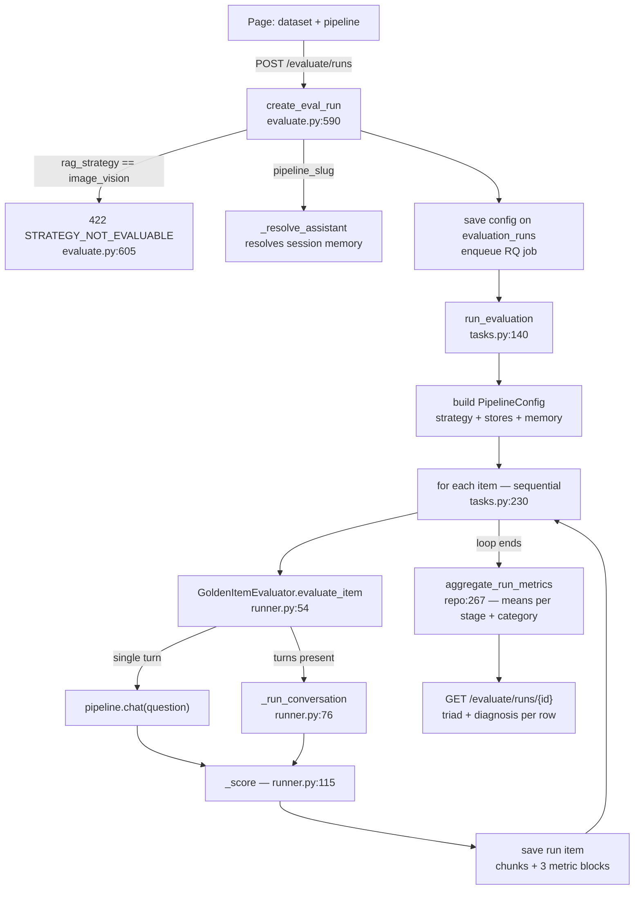

# Offline Evaluation — implementation audit, industry parity, and synthesizer-schema fit

**Date:** 2026-10-20 · **Scope:** `rag-retrieval-chat-manager` — the Offline Evaluation page, its route,
worker, evaluator, and dataset loader. **Question answered:** how the evaluation runs today; where it
stands against current industry practice; and whether a dataset produced by RAGAS `TestsetGenerator`
or the DeepEval `Synthesizer` would load and score correctly.

---

## 1. Verdict

- **The harness is structurally sound.** A row goes through the real `RAGPipeline.chat`, so every
  strategy including `self_rag` and `corrective` is measured through the branch it actually executes.
  Scores are split into three named stages, rolled up per dataset category, and read back as a stage
  diagnosis. RAGAS and DeepEval ship no equivalent of that diagnosis block.
- **Generation coverage is at parity. Retrieval coverage is below parity.** The offline path scores
  retrieval with source-locator formula metrics at one fixed depth (`k=5`). It does not run RAGAS
  `ContextPrecision` / `ContextRecall`, which exist in the installed version and already run on the
  live-chat path. `k_values` is accepted by the config and threaded through the call chain, and then
  ignored.
- **Reporting is below parity.** Means per stage and category, with no pass-rate against a threshold,
  no confidence interval, no latency, and no token cost. DeepEval reports `threshold` / `success` per
  metric; RAGAS reports token usage per run.
- **Schema fit is partial.** Both frameworks' *single-turn* rows load today. RAGAS *multi-turn* rows do
  not. DeepEval *scenario-only* conversational goldens do not. Both frameworks lose the one field the
  retrieval stage needs — a source document — so a synthesized dataset scores **zero on every
  retrieval metric** unless it is post-processed first.

---

## 2. How a run executes today



**Gates.** `image_vision` is refused server-side with `422 STRATEGY_NOT_EVALUABLE`
(`evaluate.py:605`), and the page freezes the Run button for the same reason. When the request names a
`pipeline_slug`, the route resolves that pipeline's Knowledge Product and copies its Redis session
memory prefix and TTL into the run config, so a multi-turn run drives the production memory namespace.

**Execution is one item at a time.** `run_evaluation` iterates `dataset_items` in a single `for` loop
(`tasks.py:230`). Each row makes one `pipeline.chat` call per user turn plus five judge calls. A
100-row single-turn run is therefore ~500 sequential LLM calls.

**Multi-turn scores the last turn only.** `_run_conversation` replays each user turn, appends the
exchange to session memory, and returns the final result (`runner.py:76`). The retrieval of turns
1..n-1 is discarded.

**Aggregation.** Every numeric key in each stage block becomes `mean_<key>`, computed over the rows
that carry it, plus an identical block per category (`repo:267`). The category is read from the row's
`question_type`, falling back to `category` (`repo:345`).

### 2.1 What the page shows, in order

`GoldenEvaluationsPage` (`frontend/src/pages/GoldenEvaluationsPage.tsx`, route `/golden-evaluations`)
renders the selected run in this order:

1. **Triad panel first.** `TriadPanel` with `runDiagnosis.triad` and the run diagnosis (`:1246`). The
   three means lead because they name a stage.
2. **Run actions.** "Open full run details" navigates to `EvalRunDetailPage`
   (`/golden-evaluations/runs/{id}`), which holds the per-question triad and the passages the model
   actually read.
3. **Overall KPIs** with a stage tab per block and a chart over the `mean_*` keys.
4. **Metrics by category**, one block per category with its item count.

The aggregates come from `aggregate_metrics` on the run row; the diagnosis is recomputed on read
(`_run_diagnosis`, `evaluate.py:792`) from the stored per-row metrics, so changing the rules changes
the reading of old runs without a re-run. It emits `triad`, `stage_counts`, `dominant_stage`,
`dominant_label`, `summary`, `scored_items`, and `unscored_items`.

### 2.2 The diagnosis rules

`diagnose` (`attribution.py`) is a fixed waterfall over the triad. A missing score is not a zero.

| Condition | Stage | Reading |
|---|---|---|
| all three absent | `unknown` | no stage can be named |
| `context_relevance < 0.7` | `retrieval` or `rerank` | the evidence was not fetched, or the reranker buried it |
| `response_groundedness < 0.7` | `generation_grounding` | the passages were relevant; the generator added claims |
| `answer_relevancy < 0.7` | `generation_relevance` | grounded but off the question |
| one of the three absent, nothing else failed | `unknown` | the triad is incomplete, so no stage is cleared |
| all three pass | `healthy` | sound |

The retrieval-vs-rerank split is `_winner`: the reranker is blamed only when it ran, the retriever's
ranking was measured at the same depth, and the reranked MRR fell at least `RERANK_LOSS_MARGIN` (0.05)
below it. Otherwise the retriever owns the miss.


---

## 3. What is actually measured

| Stage | Metric key | Computation | Judge? | Depth |
|---|---|---|---|---|
| retrieval | `precision` | relevant / returned | no | k=5 |
| retrieval | `recall` | matched expected sources / expected sources | no | k=5 |
| retrieval | `hit` | any relevant in top k | no | k=5 |
| retrieval | `mrr` | 1/rank of first relevant | no | full |
| rerank | `mrr_before`, `mrr_after`, `mrr_delta` | MRR of the two rankings | no | full |
| rerank | `mrr_before_at_k` | MRR before, cut to the reranker's depth | no | matched |
| rerank | `kendall_tau` | rank correlation before vs after | no | full |
| rerank | `ndcg` | graded rank quality after rerank | no | k=5 |
| generation | `faithfulness` | RAGAS `Faithfulness` | yes | - |
| generation | `accuracy`, `answer_correctness` | RAGAS `AnswerCorrectness` | yes | - |
| generation | `context_relevance` | RAGAS `ContextRelevance` | yes | - |
| generation | `response_groundedness` | RAGAS `ResponseGroundedness` | yes | - |
| generation | `answer_relevancy` | RAGAS `AnswerRelevancy` | yes | - |
| generation | `behavior_match` | answer abstained when the row said to | no | - |
| generation | `keypoint_coverage` | listed keypoints present in the answer | no | - |

`k = 5` is a literal in both metric modules (`retrieval_metrics.py:55`, `rerank_metrics.py:71`).
`EvalRunConfig.k_values` is passed down and never read. `Settings.eval_default_k = 5` exists and is
never read either.

**Thresholds exist, but only for the diagnosis.** `PASS_MARK = 0.7` and `RERANK_LOSS_MARGIN = 0.05`
(`attribution.py:27`, `:31`) drive the per-row stage label. No run-level pass rate is reported.

**Latency and cost are not recorded.** `EvalItemResult` has no latency field, yet the worker reads
`getattr(result, "latency_ms", None)` (`tasks.py`) — always `None`, so the synthetic trace carries no
latency and no token counts.

---

## 4. Parity with current practice

Industry references: RAGAS 0.4 metrics and `@experiment` reporting; DeepEval RAG metrics with
`threshold`/`success`; TruLens RAG triad; MTRAG and SemEval-2026 Task 8 for multi-turn.

| Capability | This project | RAGAS 0.4 | DeepEval | TruLens |
|---|---|---|---|---|
| Faithfulness | yes | yes | yes | groundedness |
| Answer relevancy | yes | yes | yes | yes |
| Groundedness | yes | `ResponseGroundedness` | via faithfulness | yes |
| Answer correctness | yes | `AnswerCorrectness` | yes | no |
| Context precision / recall (LLM) | **no offline** (live only) | yes | yes | no |
| Source-based precision / recall / hit / MRR | yes | no | no | no |
| nDCG, Kendall tau for the reranker | **yes** | no | no | no |
| Stage attribution with reasons | **yes** | no | no | no |
| Per-category rollup | yes | no | no | no |
| Noise sensitivity | no | yes | no | no |
| Threshold / pass rate | **no** | no | yes | no |
| Token cost / latency per run | **no** | yes | yes | yes |
| Confidence intervals | no | no (ARES-style research) | no | no |
| Parallel item execution | **no** | yes (`RunConfig`) | yes | yes |
| Multi-turn scoring of every turn | **no** (last turn only) | yes (whole conversation) | yes (whole conversation) | n/a |
| Vision / multimodal | refused by design | multimodal metrics | multimodal metrics | no |

**Reading it.** On the generation half the project is current: the triad it uses *is* the TruLens
triad, implemented with the RAGAS 0.4 `collections` API. The reranker instrumentation (`mrr_delta`,
`kendall_tau`, `mrr_before_at_k`) is ahead of all three frameworks, which treat retrieval as a single
score. The `context_precision` gap is the notable one, because the code already exists for the live
path and is simply not called offline. The `answer_relevancy` double-score was deliberately avoided
(`runner.py:149`), which is the same optimization RAGAS users usually hand-write.

The single-turn-only multi-turn scoring is the largest methodological gap: MTRAG and SemEval-2026
Task 8 both evaluate turn-level, and later-turn degradation is a documented effect (ELSER R@5 falls
from 0.89 on turn 1 to 0.47 on later turns). A run that scores only the final turn hides that.

---

## 5. Schema compatibility with the two synthesizers

### 5.1 What RAGAS 0.4.3 actually writes

Verified against the installed package, not the docs. `ragas.testset.TestsetGenerator` is the current
API (`ragas.testset.generator` does not exist in 0.4.3). `Testset.to_list()` emits
`eval_sample.model_dump(exclude_none=True)` plus `synthesizer_name`:

```json
{"user_input": "...", "reference_contexts": ["..."], "reference": "...",
 "synthesizer_name": "single_hop_specific_query_synthesizer"}
```

`SingleTurnSample` fields: `user_input`, `retrieved_contexts`, `reference_contexts`,
`retrieved_context_ids`, `reference_context_ids`, `response`, `multi_responses`, `reference`,
`rubrics`, `persona_name`, `query_style`, `query_length`.

`MultiTurnSample.user_input` is `list[HumanMessage | AIMessage | ToolMessage]`, each
`{type: "human"|"ai"|"tool", content, metadata, tool_calls}` — **`type`, not `role`**.

The synthesizers set `reference` and `reference_contexts` only (`single_hop/base.py:134`,
`multi_hop/base.py:173`). Nothing in `ragas/testset/` writes `reference_context_ids`. **A generated
RAGAS row carries no source identifier.**

### 5.2 What DeepEval actually writes

From `deepeval/dataset/golden.py`:

- `Golden`: `input`, `actual_output`, `expected_output`, `context`, `retrieval_context`,
  `additional_metadata`, `comments`, `tools_called`, `expected_tools`, `token_cost`,
  `input_token_count`, `output_token_count`, `source_file`, `name`.
- `ConversationalGolden`: `scenario`, `expected_outcome`, `persona`, `user_description`, `context`,
  `additional_metadata`, `comments`, `name`, `custom_column_key_values`, `expectations`,
  `expected_labels`, `turns`.

Two facts matter here. `ConversationalGolden` has **no `input`** field, and the loader's discriminator
is the presence of `scenario`, not the presence of `turns`. And the `Synthesizer` **does** set
`source_file` on each generated golden from the document the context came from
(`synthesizer.py`, `Golden(..., source_file=context_source_files[0])`).

CSV: lists joined on `|`; `turns`, `additionalMetadata`, and `customColumnKeyValues` cells are JSON.

### 5.3 Measured load matrix

Each shape was fed to `parse_golden_dataset_jsonl` / `parse_golden_dataset_csv` and the resulting
payload inspected:

| Input shape | Loads | What survives |
|---|---|---|
| RAGAS single-turn JSONL | yes | question, reference; `reference_context` kept; **no sources, no category** |
| RAGAS multi-turn JSONL | **no** — `role` field required | - |
| RAGAS CSV (`to_csv`) | yes, but corrupt | `reference_contexts` stored as the Python-repr string `"['X is Y.', 'X is Z.']"` |
| DeepEval `Golden` JSONL | yes | question, expected_output, context; **`additional_metadata` and `source_file` dropped** |
| DeepEval `ConversationalGolden` with `turns` | yes | turns, expected_outcome |
| DeepEval `ConversationalGolden`, scenario only | **no** — `question` required | - |
| DeepEval CSV | yes | `context` kept as one pipe-joined string; **`metadata` column kept as a string key, not unpacked** |

### 5.4 Consequences

1. **Retrieval metrics read zero on any synthesized dataset.** `recall`, `precision`, `hit`, `mrr`,
   `ndcg`, and the reranker delta all depend on `expected_sources`. Neither framework supplies a
   source locator that maps to it, and DeepEval's `source_file` — which would map directly — is
   dropped by the loader.
2. **The category rollup is empty for synthesized datasets.** The block reads `question_type` then
   `category`. RAGAS's `synthesizer_name` (single-hop vs multi-hop) is dropped; DeepEval's
   `additional_metadata` is dropped.
3. **The reference context is captured but unused.** It lands in `metadata["reference_context"]` and
   no metric reads it — so the gold passage that the generators do provide is discarded.

### 5.5 Minimal changes that make a synthesized dataset drop in

All of these are additions to `dataset_schema.py`, not a new layer:

1. `_parse_turns` (`:172`): accept `type` as `role`; map `human`→`user`, `ai`→`assistant`,
   `tool`→skip. Fixes RAGAS multi-turn. Four lines.
2. `_normalize_item` (`:231`): when a row has `scenario` and no `input`/`question`, use `scenario`
   as the question. Fixes scenario-only DeepEval conversational goldens. Two lines.
3. `_COLUMN_ALIASES` (`:134`): add `additional_metadata` as a metadata source, `source_file` to
   `source_doc_id`, and `synthesizer_name` to `question_type`. Three entries.
4. CSV path: parse a `metadata` / `additional_metadata` cell as JSON into the metadata dict instead
   of storing the raw string. One branch.

After 3, a DeepEval-generated dataset scores retrieval and gets a category without post-processing.
A RAGAS-generated dataset still needs its `reference_contexts` converted to source names, because the
framework provides no source field at all — that conversion is the one thing neither loader can do.

---

## 6. Recommendations, in order of value per line of code

**P0 — the four loader changes in §5.5.** Small, and they are the difference between "a synthesized
dataset imports" and "a synthesized dataset produces a real report".

**P0 — remove or honor `k_values`.** Today the config promises a k-sweep and delivers a constant.
Either call `compute_retrieval_metrics(..., settings.eval_default_k)` for one depth, or emit
`recall@1/3/5/10` as separate keys so the page shows the curve. The second is more useful and still
small.

**P1 — call the offline retrieval RAGAS metrics.** `calculate_retrieval_ragas_async`
(`ragas_client.py:134`) already implements `ContextPrecision` and `ContextRecall` and already runs on
the live path (`chat_metrics.py:68`). One call beside `compute_retrieval_metrics` covers the largest
metric-coverage gap. It must be skipped for `out_of_corpus` / `unanswerable` rows, which
`SKIP_PRECISION_RECALL_CATEGORIES` already names.

**P1 — report a pass rate.** `PASS_MARK` already exists. Adding `pass_rate_<metric>` to the aggregate
turns "mean faithfulness 0.82" into "82% of rows pass", which is what DeepEval's `success` column
gives and what a reviewer actually reads.

**P2 — run rows concurrently.** The loop is sequential and the per-row work is I/O-bound on
five judge calls. A bounded `ThreadPoolExecutor` over independent rows is the change with the largest
wall-clock effect; session memory already isolates each multi-turn row with its own session id.

**P2 — record latency and token cost.** `EvalItemResult` needs the fields the worker already tries to
read. Without them no run can answer "is the slower pipeline worth the extra faithfulness".

**P3 — score every turn, not only the last.** Return a per-turn list and aggregate turn 1 vs turn n.
That is what MTRAG and SemEval-2026 Task 8 measure, and it is the only way this harness would show
the documented later-turn degradation.

**P3 — report an interval.** A bootstrap CI over rows on each mean costs a few lines on a 100-row run
and prevents reading 0.72 vs 0.75 as a real difference.

---

## 7. Verification log

| Check | Result |
|---|---|
| Callers of `calculate_retrieval_ragas_async` | offline runner does not call it; `chat_metrics.py:68` does |
| `compute_retrieval_metrics` body | `k = 5` literal at `:55`; `k_values` argument unused |
| `compute_rerank_metrics` body | `k = 5` literal at `:71`; `k_values` unused |
| `EvalItemResult` fields | no latency; worker's `getattr(..., "latency_ms")` always `{}` |
| `Settings.eval_default_k`, `eval_worker_concurrency` | declared, never read anywhere |
| RAGAS installed version | 0.4.3; `ragas.testset.generator` absent; `ragas.testset.TestsetGenerator` present |
| `reference_context_ids` in `ragas/testset` | zero occurrences |
| `source_file` in DeepEval `synthesizer.py` | set on `Golden(...)` from `context_source_files[0]` |
| Load matrix (§5.3) | 7 shapes executed against the real parsers |
| `_run_conversation` return | returns `last`; earlier turns' retrieval discarded |
| Aggregation | means per stage and per category; category from `question_type` then `category` |

The compatibility matrix in §5.3 is reproducible: `outputs/check_framework_compat.py` asserts all seven
shapes and prints `7/7 as documented`. Run it with the backend venv before changing the loader.

---

## 8. Limits of this brief

- No run was executed end to end: that needs the API, RQ worker, LiteLLM proxy, and Qdrant. All
  runtime claims come from reading the executed path, and every framework-compatibility claim comes
  from running the real parsers.
- Judge-score behaviour (cost, latency, judge agreement) is not measured here. It needs one live run.
- RAGAS multi-turn *metric* semantics were read from the installed `MultiTurnSample` shape and the
  docs, not executed.
- DeepEval is not installed in this repo; its schema was read from the published source, not run.
