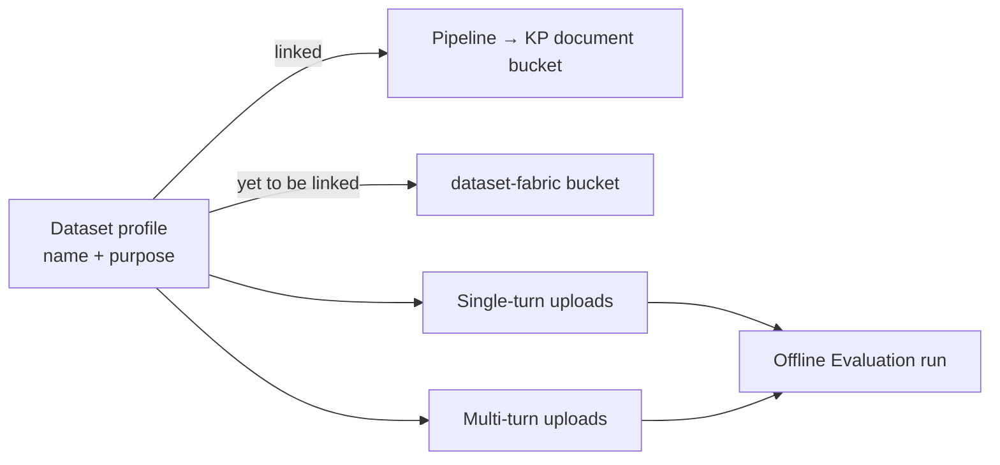

# 20 — Dataset Fabric (`/dataset-fabric`)

**Last updated:** 2026-10-20
**Page:** `frontend/src/pages/DatasetFabricPage.tsx` · **Route:** `/dataset-fabric` · **Nav label:** Dataset Fabric
**API:** `apps/rag-api/src/rag_api/routes/dataset_profiles.py` (prefix `/api/dataset-profiles`)
**Migration:** `007_dataset_profiles`

## 1. What it is

A **dataset profile** is the unit the Offline Evaluation page selects. It carries a name, a
description of its purpose, and a link to at most one RAG pipeline. A profile that names a pipeline
stores its uploaded files in that pipeline's Knowledge Product document bucket; a profile with no
pipeline stores them in one shared bucket. Both cases are valid, and the unlinked one is how a dataset
is authored before its pipeline exists.

A profile does not replace a dataset. Each upload becomes one `golden_datasets` row that points back
at the profile, so the evaluator still reads a single dataset and needs no change.

## 2. Data model

### `dataset_profiles`

| Column | Meaning |
|---|---|
| `id`, `name` (unique), `description` | Identity and purpose |
| `pipeline_slug` | The pipeline the profile grades. NULL is "yet to be linked" |
| `pipeline_name` | Snapshot, so the list renders without the ingestion service |
| `knowledge_product_id`, `knowledge_product_name` | Snapshot from the pipeline's Knowledge Product |
| `created_at`, `updated_at` | Audit |

### `golden_datasets` additions

| Column | Meaning |
|---|---|
| `profile_id` | The profile that owns this upload. NULL on a legacy dataset |
| `storage_bucket`, `storage_key` | Where the file is in MinIO |
| `original_filename`, `source_format` | What was uploaded |
| `row_count` | Rows parsed, which is what "Rows to test" is bounded by |

The existing `kind` (`single_turn` / `multi_turn`) is derived from the rows, exactly as before.

**An upload never replaces an earlier one.** Each upload inserts a new dataset row, so a run that
points at an older upload keeps its rows. The page reads the newest upload of the selected kind.

## 3. API

| Method | Path | Does |
|---|---|---|
| `GET` | `/api/dataset-profiles?pipeline_slug=` | Profiles with their datasets, newest first. The filter is what the Offline Evaluation page uses |
| `POST` | `/api/dataset-profiles` | Create. A `pipeline_slug` is resolved through the ingestion service and snapshotted |
| `PATCH` | `/api/dataset-profiles/{id}` | Rename, re-describe, or relink |
| `DELETE` | `/api/dataset-profiles/{id}` | Delete the profile, its datasets, their runs, and their files |
| `POST` | `/api/dataset-profiles/{id}/datasets` | Multipart upload: `file` + `kind` |
| `GET` | `/api/dataset-profiles/{id}/datasets/{dataset_id}` | Preview the parsed rows |
| `DELETE` | `/api/dataset-profiles/{id}/datasets/{dataset_id}` | Delete one upload and its file |

Errors: `409` on a duplicate profile name, `422` on an unsupported format, an empty file, an unknown
kind, or a file whose rows do not match the section, and `503` when MinIO or the ingestion service is
unreachable.

## 4. Accepted formats

`.csv`, `.json`, `.jsonl`, `.xlsx`, `.parquet`. All five produce the same payload.

`eval_core.dataset_schema.parse_golden_dataset_file` dispatches on the extension. The two tabular
containers go through pandas and then the CSV reader, so the column aliases and the row rules are the
same in every format.

| Format | Notes |
|---|---|
| `.csv` | The authoring format. Extra columns become metadata |
| `.json` | The wrapped object, `{"name", "items"}`. Extra scalar keys now become metadata too |
| `.jsonl` | One item per line. The only lossless form for a list-valued field |
| `.xlsx` | First sheet, read as text. Needs `openpyxl` |
| `.parquet` | Read with `pyarrow`. A list-valued column is flattened to its repr, so use JSONL for one |

A file whose rows derive a different `kind` than the section it was uploaded in is refused with
`422 KIND_MISMATCH`. That is why the single-turn and multi-turn sections are separate.

## 5. Storage

The bucket is resolved at upload time, not at profile creation:

1. A profile with no `knowledge_product_id` uses `dataset_fabric_bucket` (default `dataset-fabric`).
2. A linked profile reads `GET {ingestion}/api/knowledge-products/{id}` and takes the first
   non-`local-` `minio_bucket` of its sources, sorted by name.
3. No source, or a product the ingestion service no longer has, falls back to the shared bucket.

The object key is `datasets/{profile_id}/{kind}/{filename}`, so a single-turn and a multi-turn upload
of the same name cannot overwrite each other. The row records the bucket and key that were used.

`ponytail:` a Knowledge Product with several source buckets uses the first one, because the dataset
grades a corpus rather than a source. Widen it to a per-source choice if a run ever needs to say what
it grades. The MinIO calls are synchronous and run through `asyncio.to_thread`; a dataset of tens of
megabytes is fine, a queue is the upgrade path.

## 6. Frontend

The page is a profile rail plus a workspace, built on the app's existing tokens (`--bg-*`,
`--border-*`, `--text-*`, `--accent`, `--radius-*`) and the shared `.panel` / `.btn` / `.input` /
`.repo-table` classes. The page styles live in `index.css` under *Dataset Fabric*.

1. **Header** — one primary action, *New profile*, which opens the form. *Refresh* reloads the list.
2. **Profile form** — one panel for both actions. *New profile* opens it empty and *Edit* opens it
   prefilled; the panel title says which. It holds the name, the pipeline (first option is *Yet to be
   linked with a RAG pipeline*) and the description. Enter submits; the first field takes focus;
   *Cancel* closes it and clears its error. Selecting another profile closes it.
   The edit save sends one `PATCH` with all three fields. The route reads `null` as "leave as is", so
   an empty description and an empty pipeline slug travel as `""` to clear them. A duplicate name
   answers `409`; the message shows above the grid and the form keeps the typed values.
3. **Profile rail** — 340 px. Each row carries a monogram, the name, a link chip, the single-turn and
   multi-turn counts, and the description. The selected row uses the accent background and
   `aria-current`. No delete control sits inside the row, so there is no nested button.
4. **Workspace** — the selected profile's name, link, description, and the actions *Edit*, *Evaluate*
   and *Delete*, then two upload cards. Each card has its own count and an upload control. The upload
   is primary only while the section is empty, so the page keeps one primary action.
5. **Upload rows** — file icon, name, rows/format/age, and two real buttons: *View* and a labelled
   trash action. A result line above the cards reports the last upload or delete in the success or
   danger colour.
6. **Viewer** — a full-width panel below the grid, not inside the workspace column, so all five
   columns fit: `#`, Question, Ground truth, Type and Sources. Every cell wraps in full and no text
   is clamped. The header stays sticky while the box scrolls to `min(62vh, 640px)`. Even rows use
   `--bg-inset` and row numbers use tabular figures. Opening the viewer scrolls it into view.

Below 1100 px the rail and workspace stack. The upload cards use `auto-fit`, so they sit side by side
when the column is wide enough. Verified at 1440 px and 900 px with no horizontal scroll.

## 7. Offline Evaluation changes

The dataset list and the Hugging Face import are gone from `/golden-evaluations`. The page now works
from profiles:

1. **Pipeline configuration** stays the first control.
2. **Dataset profile** is a dropdown of the profiles whose `pipeline_slug` matches the selected
   pipeline. A profile with no pipeline never appears.
3. **Two radios** — *Only Single turn* and *Only Multi-Turn*. An option whose dataset is not uploaded
   is frozen, and its card says so instead of disappearing.
4. **Rows to test** is bounded by the chosen upload's `row_count`.
5. **LLM-as-a-judge** is unchanged.

A multi-turn choice is still blocked when the selected pipeline's Knowledge Product has no Redis
session memory, because the run replays the conversation through that memory.

## 8. Files

- `libs/database/src/rag_db/models/dataset_profile.py`
- `libs/database/src/rag_db/models/evaluation.py` (the five new columns and the `profile` relationship)
- `libs/database/alembic/versions/007_dataset_profiles.py`
- `libs/database/src/rag_db/repositories/dataset_profile_repository.py`
- `libs/eval-core/src/eval_core/dataset_schema.py` (`UPLOAD_FORMATS`, `parse_golden_dataset_dataframe`,
  `parse_golden_dataset_file`)
- `apps/rag-api/src/rag_api/dataset_storage.py`
- `apps/rag-api/src/rag_api/routes/dataset_profiles.py`
- `frontend/src/pages/DatasetFabricPage.tsx`, `frontend/src/pages/GoldenEvaluationsPage.tsx`,
  `frontend/src/api.ts`, `frontend/src/components/AppLayout.tsx`
- `tests/unit/test_dataset_fabric.py`

## 9. Verification

- `tests/unit/test_dataset_fabric.py` — 7 tests: format refusal, unknown kind, kind mismatch, empty
  file, a full upload with mocked storage and repository, an XLSX upload, and the bucket choice for a
  linked product.
- Five formats parsed from generated files: same question, answer, source and category in each.
- Page checked in the browser at 1440 px and 900 px: rail and workspace stack, cards reflow, no
  horizontal scroll, keyboard focus visible on profile rows and file rows.
- Edit checked against the running API: prefill, a saved description, the revert, the `409`
  duplicate-name message, and the error cleared by *Cancel*.
- Viewer checked at 1440 px and 900 px: five columns, no horizontal scroll, sticky header.
- Light and dark mode checked.
- `tsc -b` and `vite build` pass.
- Migration chain checked: `001` → `007`, one head.
- **Run end to end on the local stack.** Migration `007` applied to head. An unlinked profile and a
  profile linked to `my-resumes-kp-vector` were created through the API; uploads landed in
  `dataset-fabric` and in `source-my-resumes-58f07e4d` respectively, and the object keys were read
  back from MinIO. A wrong-section upload returned `422 KIND_MISMATCH`. The pipeline filter returned
  only the linked profile. One row was then run from the Offline Evaluation page and completed:
  generation means `faithfulness` 1.0, `answer_relevancy` 1.0, `context_relevance` 1.0,
  `response_groundedness` 1.0, `accuracy` 0.907, diagnosis `healthy`.
