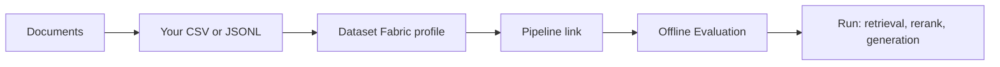

# 21 — Authoring Golden Datasets for Dataset Fabric

This document tells you how to write a single-turn and a multi-turn dataset that upload cleanly in
Dataset Fabric and run in Offline Evaluation. It ends with two copy-paste prompts you can give an
external model together with your documents.

The schema reference is [13 — Golden Dataset Requirements](./13_golden_dataset_requirements.md).
This document is the authoring guide: what to write, in what order, and what the pages do with it.

## 1. The chain



1. Write one file per kind: single-turn and multi-turn.
2. Upload each file into the matching section of one profile.
3. Link the profile to the pipeline that holds your corpus.
4. Open Offline Evaluation, pick that pipeline, pick the kind, run.

The eval page finds the profile by the pipeline slug. It uses the **newest upload of the selected
kind**. A new upload never deletes an older one, so a run that points at an older dataset stays
readable.

## 2. Before you write a row

### 2.1 Know the exact file names

`source_doc_id` is the only input the retrieval metrics have. It must match the ingested file name.
The matcher compares the value against the chunk's source locator, title and `file_name`, reduced to
a basename, by bidirectional substring. `Resume-1.pdf` matches. `Resume1` and `WB` do not.

List the names your corpus holds:

```bash
docker exec rag-ingestion-manager-qdrant-1 sh -c \
  'curl -s -H "api-key: qdrant" -X POST http://localhost:6333/collections/<collection>/points/scroll \
   -H "Content-Type: application/json" -d "{\"limit\":100,\"with_payload\":[\"file_name\"]}"' \
  | grep -o '"file_name":"[^"]*"' | sort -u
```

A wrong name is silent: `hit`, `recall`, `precision`, `mrr` and `ndcg` return `0.0` and the
generation block still scores. Check the list before the first run.

### 2.2 Decide the row count and the category mix

10 rows is the minimum that gives a stable mean. 20 to 30 rows is better when the corpus holds many
documents. The page samples `Rows to test` from the file at random on every run, so a small file
repeats rows across runs.

| `question_type` | Share | What it tests |
|---|---|---|
| `single_hop` | 40% | One fact from one passage |
| `multi_hop` | 20% | Two or more facts, often from two passages |
| `comparative_cross_document` | 10% | Two documents compared |
| `edge_case` | 10% | Missing end date, ambiguous wording, a table value |
| `out_of_corpus` | 20% | The corpus holds no answer, the system must abstain |

The `question_type` value is also the per-category key in the run's `categories` block. Keep the
spelling stable across runs, or the comparison breaks.

### 2.3 Read the two rules that cost the most

- **`reference_context` is stored, not scored.** It lands in `metadata.reference_context` and shows
  in the viewer. No metric reads it. Write a short verbatim quote for the reviewer, not a summary.
- **`expected_behavior` drives `behavior_match`.** `refuse_or_abstain` wants an abstention. Every
  other non-empty value wants a real answer. A row without the column has no `behavior_match` key
  at all.

## 3. Single-turn schema

One question and one answer per row.

| Column | Required | Accepted aliases | What it does |
|---|---|---|---|
| `question` | Yes | `user_input`, `input`, `query` | The question asked |
| `ground_truth_answer` | No | `reference`, `expected_output`, `expected_outcome` | Reference answer; enables `answer_correctness` |
| `source_doc_id` | No | `expected_sources`, `source` | Expected sources; drives `hit`, `recall`, `precision`, `mrr`, `ndcg` |
| `reference_context` | No | `reference_contexts`, `context` | Verbatim quote for the reviewer; stored only |
| `id`, `question_type`, `keypoints_covered`, `expected_behavior`, `difficulty`, `notes` | No | — | Metadata; `question_type` groups the score block |

A row with an empty `question` is skipped without an error. Check the row count after the upload.

### 3.1 How to write each field

- `question`: one fact per row. Do not name the answer inside the question.
- `ground_truth_answer`: the shortest complete answer. A number, a name, or one sentence. Leave it
  empty on a refusal row.
- `source_doc_id`: the file name, exactly. Separate two names with `;` or `,`. Do not add a `_p<page>`
  suffix: a CSV keeps it inside the name, so it adds nothing.
- `reference_context`: copy one or two sentences from the document. Do not paraphrase.
- `keypoints_covered`: `;`-separated `label=value` entries, for example `cgpa=8.49;city=Chennai`.
  Only the value side is matched. A bare tag such as `cgpa` is not measurable, and the metric is
  then absent rather than zero.
- `expected_behavior`: `answer_from_corpus` on normal rows, `refuse_or_abstain` on refusals.
- `difficulty`: `easy`, `medium` or `hard`. Metadata only.

## 4. Multi-turn schema

A conversation, replayed through the pipeline's session memory.

| Field | Required | Rules |
|---|---|---|
| `turns` | Yes | A JSON array of `{role, content}` objects. At least one `user` turn. |
| `question` | No | Leave it out, or set it to the last user turn. Any other value is rejected. |
| `ground_truth_answer` | No | The answer to the **last** user turn |
| `source_doc_id` | No | The documents the last answer needs |
| Everything else | No | Same meaning as in §3 |

Write the user turns only. The runner skips every non-user turn and asks the pipeline each user turn
in order; the pipeline's own answers fill the gaps and go into memory. An assistant turn in the file
is stored as `expected_turns` metadata and is never replayed.

The test is the dependency between turns: the second user turn must use a pronoun or an ellipsis
that only the first turn resolves — `his`, `there`, `that role`, `the same company`. Without that
dependency the row is two single-turn questions in one, and it measures nothing new.

## 5. File formats

### 5.1 Single-turn CSV

```csv
id,question_type,question,reference_context,ground_truth_answer,source_doc_id,keypoints_covered,expected_behavior,difficulty,notes
Q001,single_hop,"What CGPA did Tharun Akula obtain in his B.Tech?","CGPA: 8.49",8.49,Resume-1.pdf,cgpa=8.49,answer_from_corpus,easy,Stated in the EDUCATION section.
Q002,out_of_corpus,"What is Tharun Akula's annual salary?","NONE - the corpus holds no record of compensation","",N/A,,refuse_or_abstain,medium,No resume states compensation.
```

A field that contains a comma, a quote or a newline must be quoted. A quote inside a field doubles.

### 5.2 Multi-turn JSONL — recommended

One JSON object per line. This is the only lossless form for the `turns` array.

```jsonl
{"id":"M001","question_type":"follow_up","turns":[{"role":"user","content":"Tell me about Tharun Akula's education."},{"role":"user","content":"What was his CGPA in the B.Tech?"}],"ground_truth_answer":"8.49","reference_context":"CGPA: 8.49","expected_sources":["Resume-1.pdf"],"keypoints_covered":"cgpa=8.49","expected_behavior":"answer_from_corpus","difficulty":"easy","notes":"'His' resolves to Tharun Akula."}
{"id":"M002","question_type":"coreference","turns":[{"role":"user","content":"Which company does Rohan Sinha work for now?"},{"role":"user","content":"What is his title there?"}],"ground_truth_answer":"Senior Software Engineer at Google.","reference_context":"Google, Bangalore, India - Senior Software Engineer, May 2023 - Current","expected_sources":["resume3.pdf"],"keypoints_covered":"title=Senior Software Engineer;company=Google","expected_behavior":"answer_from_corpus","difficulty":"easy","notes":"'There' resolves to Google."}
```

In JSON, `expected_sources` is a list. A string stays one source name, so never join names with `;`
in this form.

### 5.3 Multi-turn CSV

Possible but awkward: the `turns` cell holds the JSON array, and every inner quote doubles.

```csv
id,question_type,reference_context,ground_truth_answer,source_doc_id,keypoints_covered,expected_behavior,difficulty,notes,turns
M001,follow_up,"CGPA: 8.49",8.49,Resume-1.pdf,cgpa=8.49,answer_from_corpus,easy,"'His' resolves to Tharun Akula.","[{""role"": ""user"", ""content"": ""Tell me about Tharun Akula's education.""},{""role"": ""user"", ""content"": ""What was his CGPA in the B.Tech?""}]"
```

Prefer JSONL.

## 6. Upload in Dataset Fabric

1. **Create the profile.** Name it for the purpose, for example `my-resumes-kp`. Set the RAG
   pipeline to the pipeline whose Knowledge Product holds the corpus. An unlinked profile never
   appears in Offline Evaluation.
2. **Upload the single-turn file** in the *Single-turn* card. It must hold single-turn rows.
3. **Upload the multi-turn file** in the *Multi-turn* card. It must hold rows with `turns`.
4. **Check the counts.** Each card shows `N rows` on the file row. A skipped row shows a lower count
   than the file's line count.

Accepted extensions: `.csv`, `.json`, `.jsonl`, `.xlsx`, `.parquet`. A profile can hold several files
of the same kind; Offline Evaluation uses the newest. An upload adds a new dataset row and never
deletes an older one.

### 6.1 Rejections and their message

| Message | Cause | Fix |
|---|---|---|
| `The file is empty.` | Zero bytes | Re-export the file |
| `Upload one of .csv, .json, .jsonl, .xlsx, .parquet.` | Wrong extension | Rename or export again |
| `Invalid dataset file: CSV must have a 'question' column.` | No `question` and no `turns` header | Fix the header row |
| `Invalid dataset file: turns must be a JSON array of {role, content} objects` | Bad `turns` cell | Re-quote the cell as JSON |
| `Invalid dataset file: a dataset cannot mix single-turn and multi-turn rows` | Mixed file | Split into two files |
| `This file holds multi-turn rows. Upload it in the multi-turn section.` | Wrong card | Upload in the other card |
| `question must match the last user turn of turns` | `question` disagrees with `turns` | Correct it or remove the column |
| `A dataset profile named '<name>' already exists.` | Duplicate profile name | Use another name |

## 7. Run it in Offline Evaluation

1. **Pick the pipeline.** The profile linked to it appears under *Dataset profile*.
2. **Pick the kind.** *Only Single turn* always runs. *Only Multi-Turn* needs session memory on the
   pipeline's Knowledge Product; without it the radio is frozen and the page says why.
3. **Pick the strategy.** `vector`, `lexical`, `hybrid`, `self_rag` or `corrective`. Image Vision RAG
   is refused.
4. **Set Rows to test.** The page draws a random sample on every run and clamps it to the file size.
5. **Run.** Retrieval and rerank use fixed `k = 5`; generation uses the judge.

## 8. Which column drives which metric

| Column | Metric | Needs |
|---|---|---|
| `source_doc_id` | `hit`, `recall`, `precision`, `mrr`, `ndcg` | A name that matches an ingested file |
| `ground_truth_answer` | `answer_correctness` / `accuracy` | A non-empty answer |
| `expected_behavior` | `behavior_match` | The column present |
| `keypoints_covered` | `keypoint_coverage` | `label=value` entries whose values appear in the answer |
| `question_type` | The `categories` block | The column present |
| `turns` | The multi-turn path | At least one user turn and session memory |

Not scored: `reference_context`, `id`, `difficulty`, `notes`. They help the reviewer, not the score.

### One question-type field on all three pages

The Synthetic Datasets page names a row's type by the evolution that produced it (`reasoning`,
`multicontext`, `concretizing`, `constrained`, `comparative`, `hypothetical`, `in_breadth`). The
Uploaded Datasets and Dataset Validator pages show the same field and suggest the same names, but
they also accept a value you already use, such as `follow_up`. The row stores it twice: as
`question_type` and as a one-item `metadata.evolutions`, so every page reads one field.

## 9. Check the file before the upload

```bash
cd rag-retrieval-chat-manager/backend
source .venv/Scripts/activate      # Windows Git Bash; use .venv/bin/activate elsewhere
python - <<'PY'
from pathlib import Path
from eval_core.dataset_schema import parse_golden_dataset_file

for path in Path("../../resumes").glob("*golden*.csv"):
    payload = parse_golden_dataset_file(path.read_bytes(), path.name)
    print(path.name, payload.kind, len(payload.items), "rows")
PY
```

A clean file prints its kind and its row count. A failure prints the same message the upload returns.

Checklist:

- [ ] The header has `question`, or `turns` for a multi-turn file.
- [ ] Every `source_doc_id` value appears in the corpus listing from §2.1.
- [ ] No row mixes kinds with another row.
- [ ] Refusal rows carry `expected_behavior=refuse_or_abstain` and no ground truth.
- [ ] `keypoints_covered` values appear word for word in the expected answer.
- [ ] `question_type` uses the same spelling on every run.

## 10. Prompt A — single-turn dataset

Give the model your documents and this text. Replace the placeholders in `{{ }}`.

```text
You are building a golden evaluation dataset for a retrieval-augmented generation pipeline.

INPUT
- Attached documents: {{DOCUMENTS}}. Use each document's file name exactly as attached.
- Row count: {{ROW_COUNT}}.
- Category mix: {{CATEGORY_MIX}}. Default: 40% single_hop, 20% multi_hop,
  10% comparative_cross_document, 10% edge_case, 20% out_of_corpus.

OUTPUT
Return one CSV file and nothing else: no explanation, no markdown fence.
The header must be exactly:
id,question_type,question,reference_context,ground_truth_answer,source_doc_id,keypoints_covered,expected_behavior,difficulty,notes

RULES
1. Ground every answer in the attached documents. Never use outside knowledge.
2. `reference_context` is a verbatim quote of one or two sentences from the document that holds
   the answer. Do not paraphrase.
3. `source_doc_id` is the exact file name of that document. Use `;` between two names.
   Never invent a name and never add a page suffix.
4. `ground_truth_answer` is the shortest complete answer: a number, a name, or one sentence.
   Leave it empty for an `out_of_corpus` row.
5. `expected_behavior` is `answer_from_corpus` on every normal row, and `refuse_or_abstain` on
   every `out_of_corpus` row.
6. `question_type` is exactly one of: single_hop, multi_hop, comparative_cross_document,
   edge_case, out_of_corpus.
7. `keypoints_covered` holds `;`-separated `label=value` pairs. Each value must appear word for
   word in the expected answer. Leave it empty when there is no such value.
8. `difficulty` is one of easy, medium, hard. `notes` is one short sentence that says why the row
   exists, on one line.
9. Ids run Q001, Q002, ... with no gaps and no duplicates.
10. Quote every field that contains a comma, a quote or a newline. Double a quote inside a field.
11. One fact per `single_hop` question. `multi_hop` needs at least two facts. A
    `comparative_cross_document` row names two documents. An `edge_case` row uses a missing end
    date, an ambiguous label or a table value that is easy to misread.
12. An `out_of_corpus` row asks for something the documents never state, such as a salary, a phone
    number or a degree that no document lists. Set `ground_truth_answer` empty, `source_doc_id` to
    N/A, and `expected_behavior` to `refuse_or_abstain`.
13. Do not repeat a question. Do not put the answer inside the question. Do not write a question
    that a document answers with "yes" or "no" alone.
14. Before you answer, check each row: does the quoted context contain the answer, and does the
    source name match an attached file? Fix the row when either fails.
```

## 11. Prompt B — multi-turn dataset

Give the model your documents and this text. Replace the placeholders in `{{ }}`.

```text
You are building a multi-turn golden evaluation dataset for a retrieval-augmented generation
pipeline that keeps session memory.

INPUT
- Attached documents: {{DOCUMENTS}}. Use each document's file name exactly as attached.
- Conversation count: {{ROW_COUNT}}.
- Mix: {{CATEGORY_MIX}}. Default: 40% follow_up, 40% coreference, 20% multi_turn_multi_hop.

OUTPUT
Return JSONL and nothing else: one JSON object per line, no explanation, no markdown fence.
Each object has these keys:
id, question_type, turns, ground_truth_answer, reference_context, expected_sources,
keypoints_covered, expected_behavior, difficulty, notes

RULES
1. `turns` is a JSON array of two or three objects. Every object has role "user".
   Never add an assistant turn: the evaluation replays the user turns through the live pipeline,
   and the pipeline's own answers fill the gaps.
2. The second and third user turns must depend on the first. Use a pronoun or an ellipsis that
   only the first turn resolves: his, her, there, that role, the same company, that figure.
   A turn that makes sense on its own is not a multi-turn row.
3. The graded question is the last user turn. `ground_truth_answer` answers that last turn only.
4. Do not include a `question` key.
5. `expected_sources` is a JSON list of exact file names. A string stays one name, so never join
   names with a semicolon.
6. `question_type` is exactly one of: follow_up, coreference, multi_turn_multi_hop.
   - follow_up: the last turn narrows the first turn's topic.
   - coreference: the last turn points back with a pronoun or an ellipsis.
   - multi_turn_multi_hop: the answer needs a fact from the first turn plus a fact the last turn
     asks about.
7. `reference_context` is a verbatim quote of one or two sentences from the document that holds
   the answer to the last turn. Do not paraphrase.
8. `ground_truth_answer` is the shortest complete answer to the last turn.
9. `keypoints_covered` holds `;`-separated `label=value` pairs whose values appear word for word
   in the expected answer.
10. `expected_behavior` is `answer_from_corpus` on every row of this file.
11. `difficulty` is one of easy, medium, hard. `notes` says in one sentence how the last turn
    resolves, for example "'His' resolves to Tharun Akula."
12. Ids run M001, M002, ... with no gaps and no duplicates.
13. Ground every answer in the attached documents. Never use outside knowledge.
14. Before you answer, check each conversation: does the last turn need the first turn, is the
    quoted context in the intended document, and does the expected answer solve the last turn?
```

## 12. Reference: the resume datasets

Two files in `resumes/` are live and validated. Copy their headers when you start a new file.

| File | Kind | Rows | Header |
|---|---|---|---|
| `resume_single_turn_golden.csv` | single_turn | 10 | `id,question_type,question,reference_context,ground_truth_answer,source_doc_id,keypoints_covered,expected_behavior,difficulty,notes` |
| `resume_multi_turn_golden.csv` | multi_turn | 10 | the same, plus `turns` as the last column |

The single-turn file covers 4 single-hop, 2 multi-hop, 1 cross-document comparison, 1 edge case and
2 out-of-corpus rows. The multi-turn file covers 4 follow-ups, 4 coreference rows and 2 multi-turn
multi-hop rows. Both were uploaded to profile `my-resumes-kp` on pipeline `resume-q-a`, and Offline
Evaluation reads 10 rows per kind.

## 13. Files

| Path | Role |
|---|---|
| `libs/eval-core/src/eval_core/dataset_schema.py` | CSV, JSON, JSONL, XLSX and Parquet parser; aliases; `kind` derivation |
| `libs/eval-core/src/eval_core/source_match.py` | `source_doc_id` to chunk matching |
| `libs/eval-core/src/eval_core/custom_metrics.py` | `behavior_match`, `keypoint_coverage` |
| `libs/eval-core/src/eval_core/runner.py` | The multi-turn replay through session memory |
| `apps/rag-api/src/rag_api/routes/dataset_profiles.py` | Upload, kind check, bucket write, import |
| `frontend/src/pages/DatasetFabricPage.tsx` | Profiles and uploads |
| `frontend/src/pages/GoldenEvaluationsPage.tsx` | Profile lookup by pipeline slug, memory gate |
